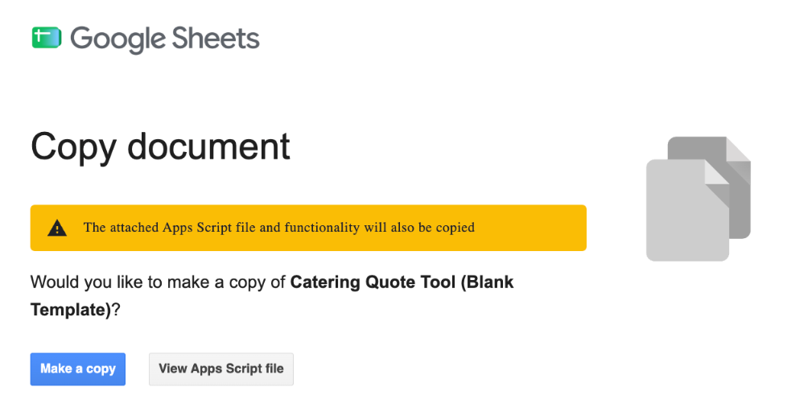
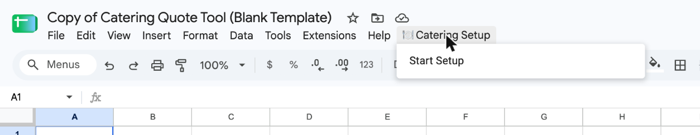
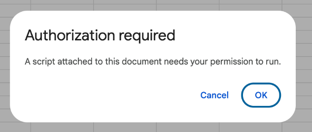
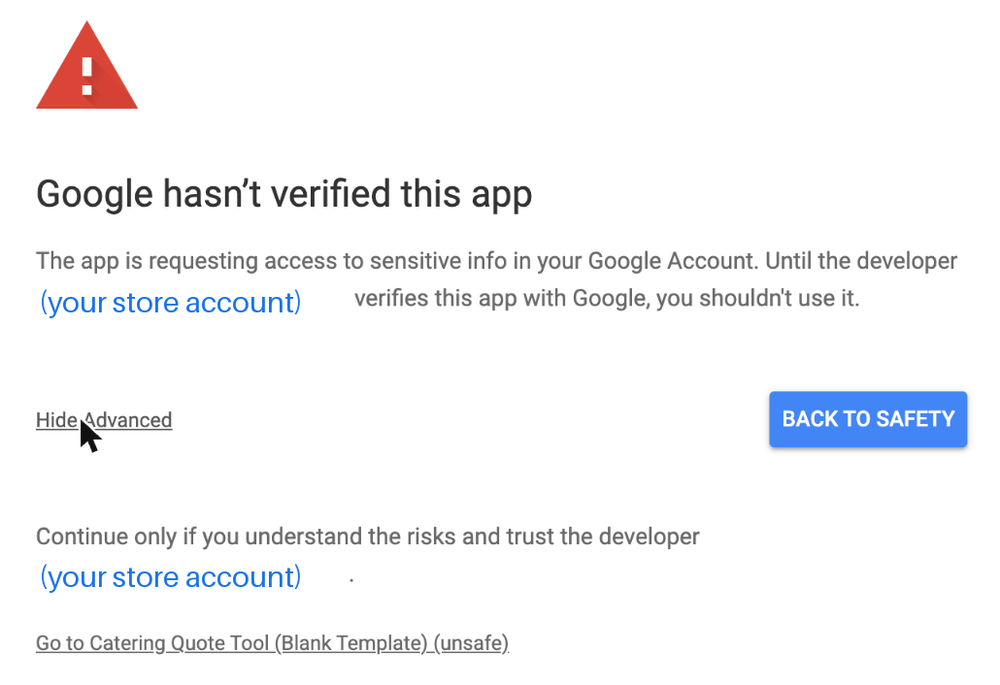
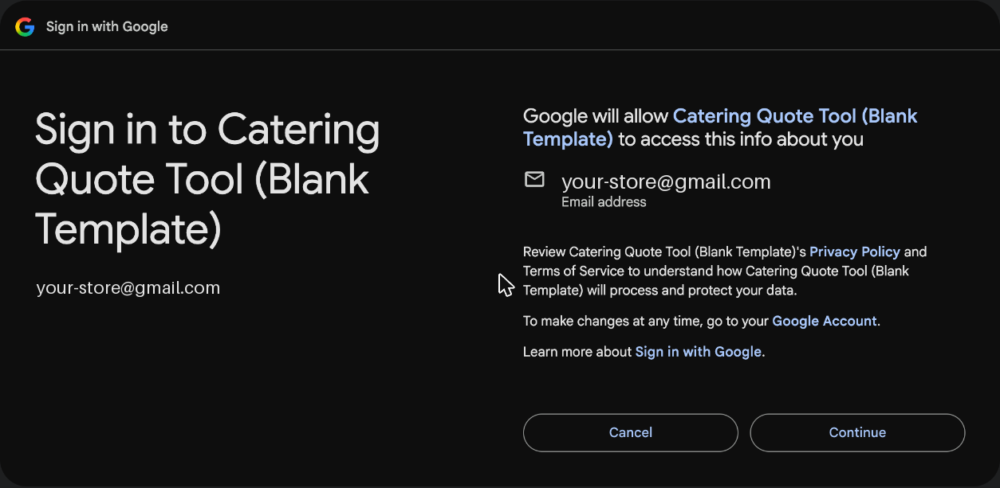
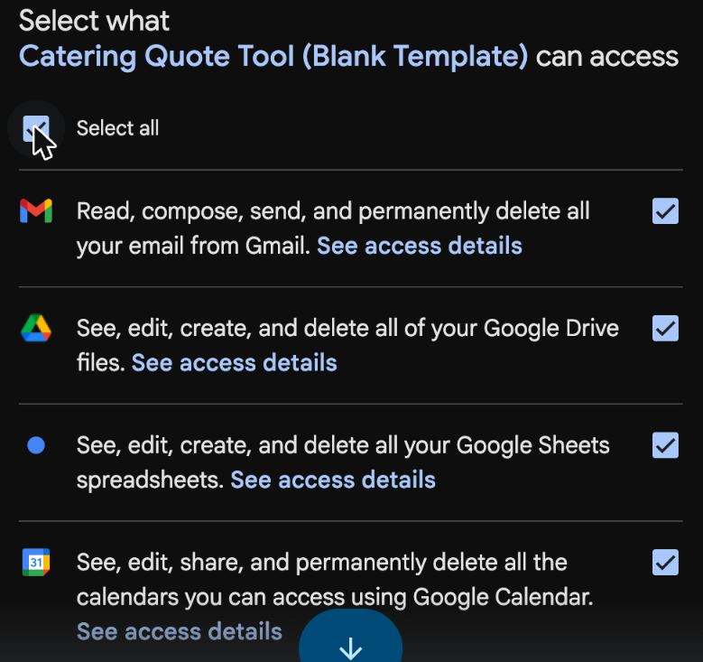
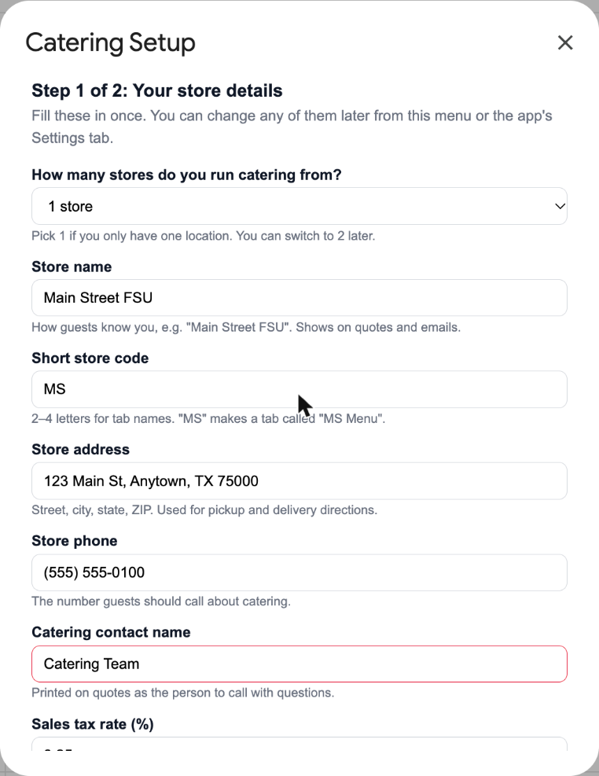
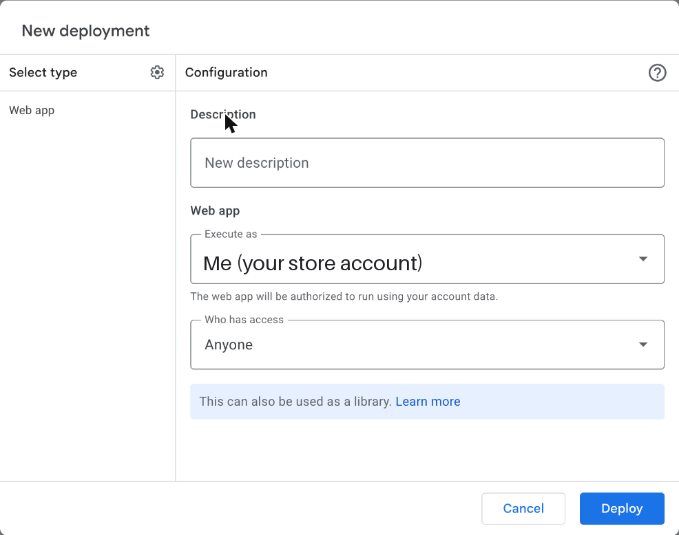

# Catering Quote Tool — Setup Guide

This gets your restaurant's catering tool running from scratch. You don't need to know anything about code, and you'll never have to open or paste any. **Plan on about 20 minutes, on a computer** (not a phone).

---

## Before you start

Have these ready. The setup asks for each one once:

- [ ] **A Google account for your store,** not your personal one. Quotes, emails and calendar events go out from whichever account makes the copy, so use the one your team shares.
- [ ] **Your store name** as guests know it, e.g. "Main Street FSU"
- [ ] **A short code** for your store, 2–4 letters, e.g. "MS". It's only used to label tabs.
- [ ] **Your store's address and phone number**
- [ ] **The name to put on quotes** as the catering contact
- [ ] **Your sales tax rate**, e.g. 8.25
- [ ] **The email address(es) that should get order alerts**
- [ ] **Running catering from a second store?** Have its name, short code, address and phone too.
- [ ] **CFA Home access,** to pull your menu prices in Step 6

---

## Step 1: Make your own copy

1. Click this link: **[Make my copy of the Catering Quote Tool](https://docs.google.com/spreadsheets/d/1XSYzm4LlGSx1x2GskjI8m49229IaFiP-5GTe0YdRR9g/copy)**. If Google asks you to sign in first, use your store account.
2. Google shows a **Copy document** screen. The yellow note says the attached script will be copied too. That's the tool itself, and it's supposed to come along.
3. Click the blue **Make a copy** button.

Your copy opens, named "Copy of Catering Quote Tool (Blank Template)". You can rename it any time by clicking the name. It's blank and belongs only to you. Nobody else can see what you put in it.

## Step 2: Start the setup

1. Wait about 10 seconds for the sheet to finish loading.
2. In the menu bar at the top (File, Edit, View…), click **🍽️ Catering Setup**, then **Start Setup**.

Don't see 🍽️ Catering Setup? Reload the page and wait a little longer. It's always the last item in the menu bar.

## Step 3: Give the tool permission (one time only)

Google asks you to approve the tool before it can make quotes, send emails and add calendar events. You'll see **four screens** in a row. This is normal, and you only do it once. The sign-in screens open in a **new tab**.

**Screen 1: "Authorization required."** Click **OK**. If Google asks which account to use, pick your store account.

**Screen 2: "Google hasn't verified this app."** This looks alarming, but it's expected. The "app" is your own copy, so the developer named on that screen is your own account. Google shows this for any spreadsheet tool that isn't sold in its store.
1. Click **Advanced** (small gray link, bottom left).
2. Click **Go to Catering Quote Tool (Blank Template) (unsafe)** at the bottom.

**Screen 3: "Sign in to Catering Quote Tool."** Check it shows your store account, then click **Continue**.

**Screen 4: the list of permissions.** Every box starts **unticked**.
1. Tick **Select all** at the top of the list. ⚠️ **Don't skip this.** If any box is left unticked, emails, tax-form uploads or calendar events will quietly fail later.
2. Scroll to the bottom and click **Continue**.

The sign-in tab closes itself, and you're back in your sheet.

## Step 4: Answer the setup questions

The sheet now builds about 30 tabs. **This takes about a minute,** and you'll see tabs appearing along the bottom. Don't close the page.

When it's done, a **Catering Setup** box opens:

1. **How many stores do you run catering from?** Pick **1 store** or **2 stores**. Picking 2 adds four questions about your second store.
2. Fill in every box from your checklist.
3. Click **Save and continue**.

If something's missing, a red message at the top of the box tells you what to fill in.

## Step 5: Publish the app

This turns your sheet into the catering app your team uses. The setup box shows these same steps, so you can follow along there.

1. In the menu bar, click **Extensions → Apps Script.** A new tab opens. Leave the code alone. If a "You're currently signed in as…" box pops up, check it's your store account and click **OK**.
2. Click the blue **Deploy** button (top right), then **New deployment**.
3. Click the ⚙️ gear next to "Select type", then **Web app**.
4. Check that **Execute as** says **Me** and **Who has access** says **Anyone**. They're usually filled in already.
5. Click **Deploy**. If Google asks again, click **Authorize access** and approve it the same way as Step 3.

6. Copy the **Web app URL** and add **`?view=app`** to the end. **That's your team's link.** Bookmark it and share it with your catering team only.

**Why "Anyone"?** Guests who send tax-exempt forms upload them without a Google login. Your team's screens only open with `?view=app` on the end, so don't post that link anywhere public.

## Step 6: Add your menu prices

1. In **CFA Home**, go to **Backoffice**, search for your restaurant and open **Menu Price Group**.
2. Click **« Select a different price group**, click your location, then **Export this to an Excel spreadsheet**.
3. Open the export. Copy the four columns: **Category, Item Name, Pickup Price, Delivery Price**.
4. In your Google Sheet, open the tab called **[your code] Menu** (e.g. **MS Menu**) and paste them in under the headers.

Type **N/A** in Delivery Price for anything you don't deliver. It'll be hidden from delivery quotes.

## Step 7 (optional): Turn on the extras

All of these are in your app's **Settings** tab, and each one is off until you turn it on:
- **Daily Automation:** day-before confirmation emails and missing-PO alerts
- **Reminders:** follow-up emails on quotes that haven't been answered
- **Logo:** upload your store's logo for the quote PDF

**Tax-exempt guests:** the **Tax Forms** tab has a QR code you can download and print for the manager stand. Walk-in guests scan it to upload their certificate.

---

## How to know it worked

1. Open your team link (the one ending in `?view=app`).
2. Your **store name** shows at the top, and there's **no yellow "Finish setup" bar**.
3. Start a new quote and add one item. In the preview, check that your store's **address and phone** are correct.

If all three look right, you're done.

---

## If something goes wrong

**1. Emails don't send, tax forms won't upload, or you see "You do not have permission to call…"**
A permission box was left unticked in Step 3. To fix it:
1. Click **Extensions → Apps Script**.
2. In the dropdown next to **▶ Run** at the top, pick **initializeSheet**, then click **▶ Run**.
3. When Google asks, tick **Select all** and click **Continue**.

This only adds the missing permission. It never erases anything in your sheet.

**2. Your team link shows "You need access" or a plain page saying the link isn't valid.**
- Make sure the link ends in **`?view=app`**.
- In Apps Script, open **Deploy → Manage deployments → ✏️** and check that **Execute as** is **Me** and **Who has access** is **Anyone**. Click **Deploy** to save.
- Only the account that owns the copy should publish it. If someone else published it, sign in as the owner and publish again.

**3. A change you made doesn't show up in the app, or the 🍽️ Catering Setup menu is missing.**
- **The app didn't change:** your team link runs the last version you published. Publish again with **Deploy → Manage deployments → ✏️ → Version: New version → Deploy**. The link stays the same.
- **The menu is missing:** reload the sheet and wait about 10 seconds. You can re-run **Start Setup** any time to change your answers. It shows what you entered before and never erases data.
