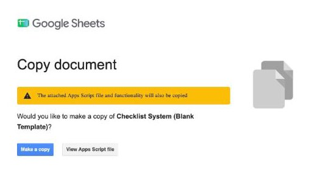
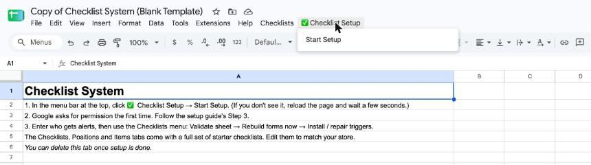
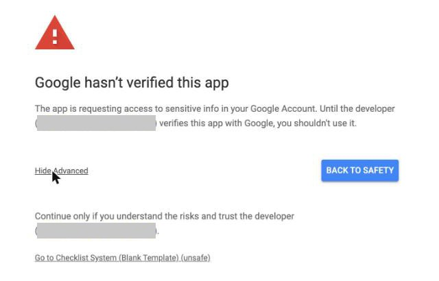
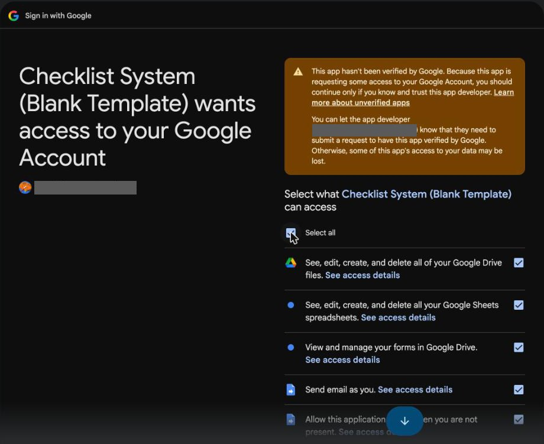
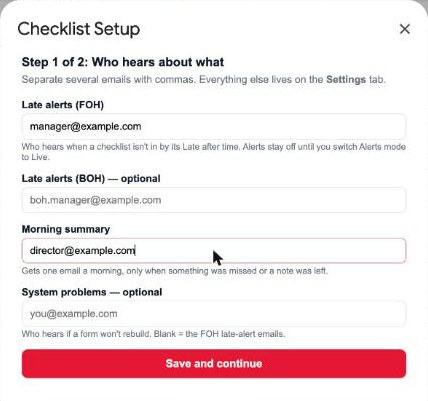
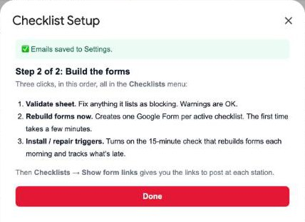
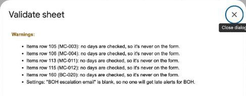
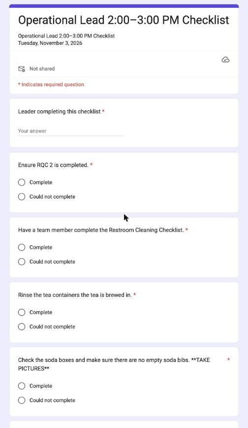
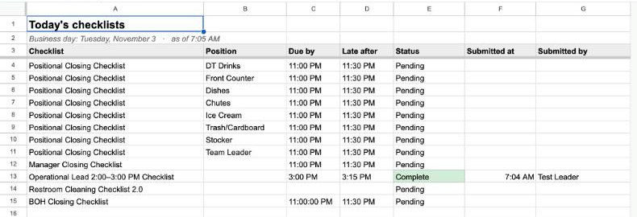

# Checklist System — Setup Guide

This gets your store's checklist system running: Google Forms that rebuild themselves each morning with that day's tasks, a live **Today** tab that shows what's done and what's late, late alerts, and a morning email when something was missed. You don't need to know anything about code. **Plan on about 30 minutes, on a computer** (not a phone).

It comes with a full set of starter checklists (positional closing, manager closing, 2–3 PM, restroom, BOH closing in Spanish, a Sunday rotation and a facilities walk). You'll edit them to match your store in Step 6.

---

## Before you start

Have these ready:

- [ ] **A Google account for your store,** not your personal one. The forms, triggers and photos belong to whichever account makes the copy, so use the one that will run the system long-term.
- [ ] **The email address(es) for late alerts** (usually the closing managers)
- [ ] **The email address(es) for the morning summary** (usually the Operator or Director)

---

## Step 1: Make your own copy

1. Click this link: **[Make my copy of the Checklist System](https://docs.google.com/spreadsheets/d/1rMT4w5n6-iBSRKrFwDsFeVtnfRWqrUQLQ8Jw4C6AQDk/copy)**. If Google asks you to sign in first, use your store account.
2. Google shows a **Copy document** screen. The yellow note says the attached script will be copied too. That's the tool itself, and it's supposed to come along.
3. Click the blue **Make a copy** button.

Your copy opens, named "Copy of Checklist System (Blank Template)". Rename it to something like "Main Street Checklists".

## Step 2: Start the setup

1. Wait about 10 seconds for the sheet to finish loading.
2. In the menu bar at the top, click **✅ Checklist Setup**, then **Start Setup**. (You'll also see a **Checklists** menu. You'll use it in Step 5.)

Don't see ✅ Checklist Setup? Reload the page and wait a little longer. If it still isn't there after two reloads, make a new copy from the Step 1 link.

## Step 3: Give the tool permission (one time only)

Google asks you to approve the tool before it can build forms, log submissions and send alerts. This is normal, and you only do it once. The sign-in screens open in a **new tab**.

**"Authorization required."** Click **OK**. If Google asks which account to use, pick your store account.

**"Google hasn't verified this app."** This looks alarming, but it's expected. The "app" is your own copy, so the developer named on that screen is your own account.
1. Click **Advanced** (small gray link, bottom left).
2. Click **Go to Checklist System (Blank Template) (unsafe)** at the bottom.

**"Sign in to Checklist System."** Check it shows your store account, then click **Continue**.

**The list of permissions.** Tick **Select all** at the top, then click **Continue**. Google Drive access is for saving checklist photos into a folder in your store's Drive.

The sign-in tab closes and the setup carries on in your sheet by itself.

## Step 4: Enter who hears about what

1. **Late alerts (FOH):** who hears when a checklist isn't in by its late time.
2. **Late alerts (BOH):** optional, for the BOH closing checklist.
3. **Morning summary:** who gets the morning email. It only sends when something was missed, a task was marked "Could not complete", or a note was left. A clean night sends nothing.
4. **System problems:** optional. Blank = the FOH late-alert emails.
5. Click **Save and continue**.

Late alerts stay off at first. For the first week only the morning summary goes out, so you can tune due times before anyone gets pinged. Step 8 turns them on.

## Step 5: Build the forms

The setup box lists three steps. Do them in order from the **Checklists** menu:

1. **Checklists → Validate sheet.** It lists anything that would block a form. Warnings (like a task with no days ticked) are fine.

   

2. **Checklists → Rebuild forms now**, then **Yes**. It creates one Google Form per active checklist. **The first time takes about 2 minutes.** Wait for "Forms rebuilt for …".
3. **Checklists → Install / repair triggers**, then **Yes**. This turns on the 15-minute check that rebuilds the forms each morning, logs submissions and marks what's late.

Then **Checklists → Show form links** lists every form. Open one in a private/incognito window to check it opens without signing in. If it asks you to sign in, open the form, click **Publish**, and set Responders to **Anyone with the link**.

Post each link (or a QR code of it) where that checklist gets done. **The links never change**, even though the questions change every day.

## Step 6: Make the checklists yours

Everything is edited in the sheet. Nothing needs code.

- **Add a task:** **Checklists → Add a task**. Pick the checklist, position, days and where it goes.
- **Change or turn off a task:** **Checklists → Edit a task**. Tasks are turned off, not deleted, so their history stays.
- **Change a due or late time:** the **Checklists** tab, **Due by** / **Late after** columns.
- **Turn a whole checklist on or off:** the **Checklists** tab, **Active** column.
- **Positions** (the stations on the positional closing checklist): the **Positions** tab.

The starter tasks mention tools some stores use (a Slack channel for end-of-day notes, RQC, Signal, Compliance Mate). Edit or turn off any that don't fit your store.

Two starter checklists start **off**:
- **Sunday Rotation:** set its **Rotation start** to the Sunday that should be Week 1, then tick **Active**.
- **Daily Facilities Walk:** print its codes with **Checklists → Print station QR codes**, post one at each station, then tick **Active**.

Edits show up on the next morning's forms. For same-day changes, use **Checklists → Rebuild forms now**.

## Step 7 (optional): Photo uploads

Some tasks ask for a photo. To let team members upload photos from their phone without signing in:

1. In the menu bar, click **Extensions → Apps Script**.
2. Click **Deploy → New deployment**. Check it says **Web app**, **Execute as: Me** and **Who has access: Anyone**, then click **Deploy**.
3. Copy the **Web app URL** (it ends in `/exec`) into the **Settings** tab, **Photo upload page** row.
4. Type a random mix of letters and numbers into **Photo upload key** (e.g. `k7q2m9xp4w`). Change it any time to retire old links.
5. Run **Checklists → Rebuild forms now**. Every form now shows the photo upload link.
6. **Checklists → Show form links** lists the photo page link for a QR code.

Photos are saved in a **Checklist Photos** folder in your store's Drive. Managers look at them with **Checklists → View photos**. Share that folder with them first (Viewer).

## Step 8: Go live

1. Run one week as is. Only the morning summary goes out.
2. Adjust **Due by** / **Late after** times on the **Checklists** tab from what actually happens.
3. On the **Settings** tab, change **Alerts mode** from `Digest only` to `Live`. Late alerts start on the next 15-minute check.

---

## How to know it worked

1. **Checklists → Show form links** lists a link for every active checklist.
2. Submit one checklist yourself (for example the 2–3 PM checklist).
3. Open the **Today** tab. That row now says **Complete**, with the time and your name.

4. The **Submissions** tab has one row, and **Item Results** has one row per task.

If all four look right, you're live. To clear your test, delete its rows on **Submissions** and **Item Results**.

---

## If something goes wrong

**1. A form didn't rebuild.**
The **System problems** email gets a "NOT rebuilt" message saying what to fix (usually a checklist with no due time or a blank task). Fix it on the sheet, then run **Checklists → Rebuild forms now**.

**2. A form asks people to sign in.**
Open the form, click **Publish**, and set Responders to **Anyone with the link**.

**3. Submissions don't show up on the Today tab.**
Run **Checklists → Install / repair triggers** again from the store account. Triggers only work for the account that installed them.

**4. "Authorization required" after a while.**
Run **Checklists → Validate sheet** once and approve. Google is asking for a permission a newer feature needs.

**5. The ✅ Checklist Setup or Checklists menu is missing.**
Reload twice. If it's still missing, make a fresh copy from Step 1.

The full reference (every setting, how the morning rebuild works, time rules) is on the **[What It Does](README.md)** page.
