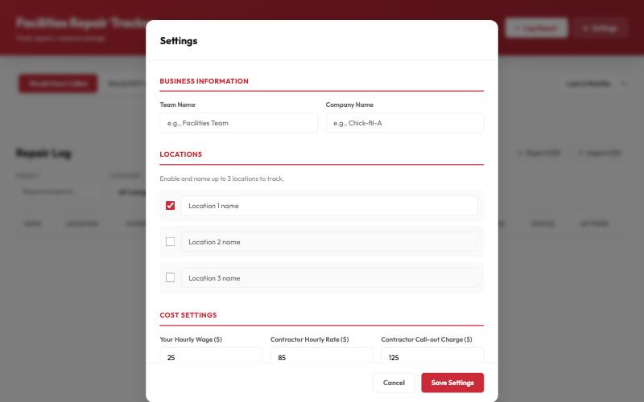
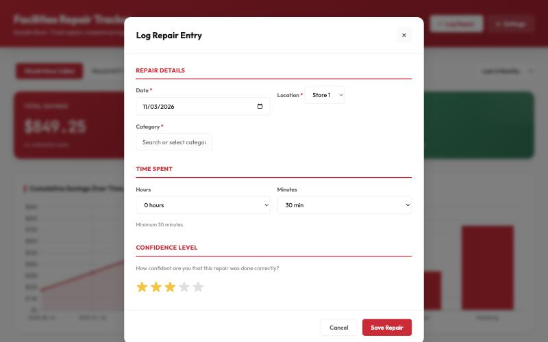
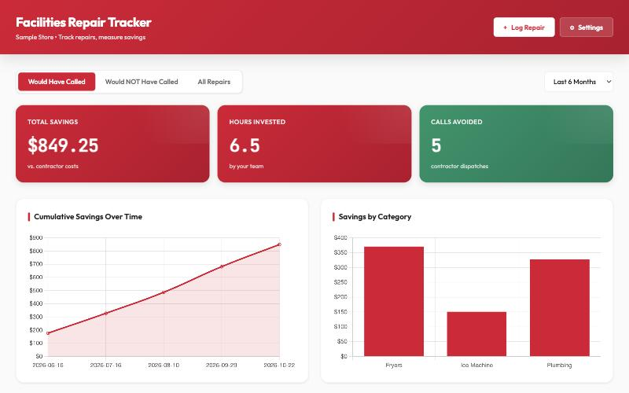

# Facilities Repair Tracker — Setup Guide

Log every repair your team handles in-house next to what a contractor would have charged, so the savings add up where everyone can see them. It's one web page. There's nothing to install and no Google setup. **Plan on about 5 minutes, on a computer or tablet.**

---

## Before you start

- [ ] **A computer or tablet with Chrome, Edge or Safari,** connected to the internet. Use the same device each time (see "Where your data is kept").
- [ ] **Up to 3 location names,** e.g. your store and a second store
- [ ] **The hourly wage** of whoever does the repairs
- [ ] **A typical contractor's hourly rate and call-out charge**
- [ ] **Optional:** your equipment categories, e.g. Fryers, Ice Machine, Plumbing. You can also add them as you go.

---

## Step 1: Open the tool

Click **[Open the Facilities Repair Tracker](facilities-tracker.html)**. Bookmark the page so you can come back to it.

Want a copy that lives on your computer instead? Right-click the same link, choose **Save Link As…**, and open the saved file whenever you need it.

## Step 2: Fill in Settings (first time only)

The **Settings** window opens by itself the first time. It won't close until it's saved.

1. Enter a **Team Name** and **Company Name**. They show in the page header.
2. Name **Location 1**. Tick and name Locations 2 and 3 if you track more than one store.
3. Enter **Your Hourly Wage**, **Contractor Hourly Rate** and **Contractor Call-out Charge**.
4. Add **Equipment Categories** with **+ Add Category** (optional).
5. Click **Save Settings**.

You can change any of this later with the **⚙ Settings** button.

## Step 3: Log a repair

1. Click **+ Log Repair**.
2. Pick the date and location.
3. Pick a **Category**, or type a new one and choose **+ Add**. Then do the same for the **Item**.
4. Set the time spent. The minimum is 30 minutes.
5. Set your confidence in the fix, 1–5 stars.
6. Leave **I would have called a contractor** ticked if you would have. If not, untick it and say why (at least 80 characters).
7. Describe the problem and the fix (at least 120 characters).
8. Click **Save Repair**.

## Step 4: Back up regularly

Click **↓ Export CSV** in the Repair Log once a month and keep the file somewhere safe. **↑ Import CSV** brings a backup in on another computer. Import adds to what's there; it doesn't replace it, so import a file only once.

---

## How savings are worked out

- **Contractor cost** = call-out charge + (contractor hourly rate × your time × 0.7). The 0.7 assumes a contractor finishes about 30% faster than your team.
- **Your cost** = your hourly wage × your time.
- **Savings** = contractor cost − your cost. Only repairs marked "would have called" count toward Total Savings.

## Where your data is kept

- **Nothing is uploaded anywhere.** Your settings and repairs are saved **in this browser on this computer only.**
- A different computer, a different browser or a private window starts empty. So does clearing your browser data.
- The online link and a saved copy on your computer keep separate logs.
- To share the log between two people, use **Export CSV** on one device and **Import CSV** on the other.

## How to know it worked

- The header shows your team name, and the dashboard cards show Total Savings, Hours Invested and Calls Avoided.
- Your repair appears in the **Repair Log** table at the bottom.
- Close the tab and open it again. Your repairs are still there.

## If something goes wrong

1. **Save Repair won't save.** A message tells you what's missing: a category, an item, or a description under 120 characters. The counter under each box turns green when it's long enough.
2. **My repairs disappeared.** You're probably on a different computer or browser, in a private window, or the browser data was cleared. Open the tool where you logged them, or use **↑ Import CSV** with your last export.
3. **"Warning: Unable to save data."** The browser is in private mode or blocks storage. Open the tool in a normal window.
