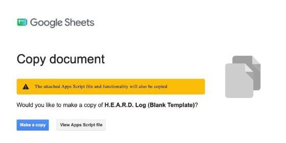
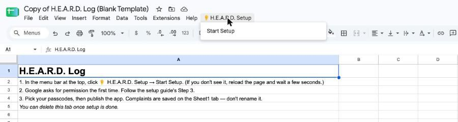
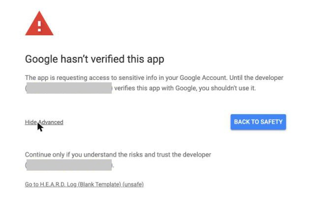
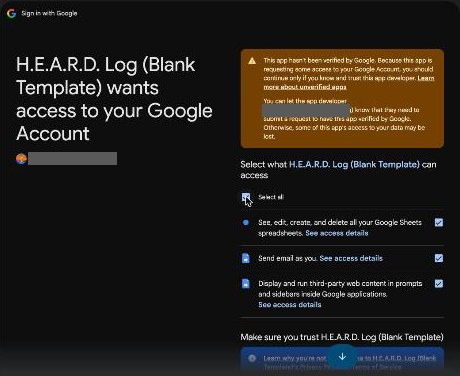
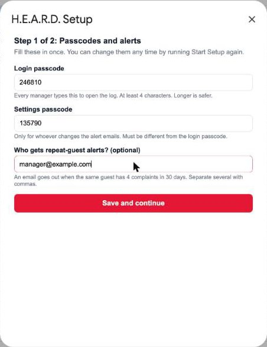
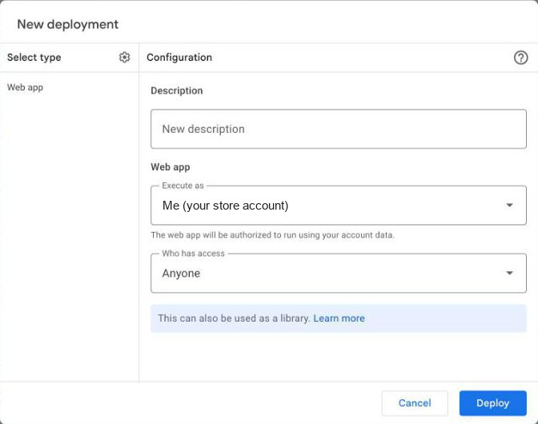
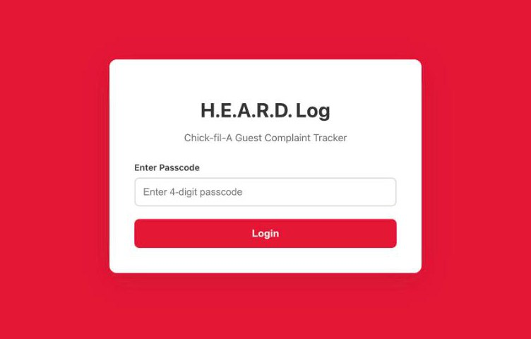
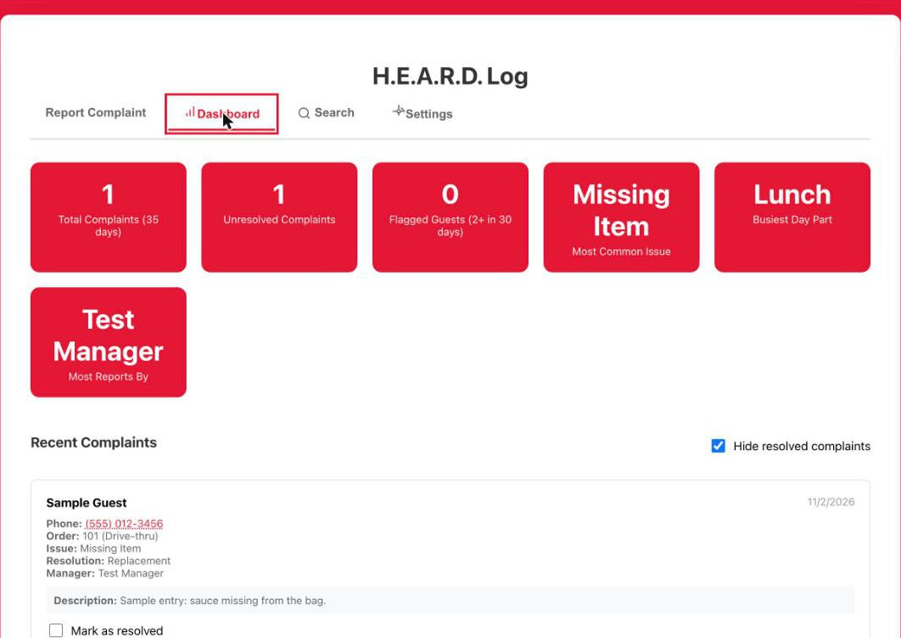

# H.E.A.R.D. Log — Setup Guide

This gets your store's guest-recovery log running from scratch. You don't need to know anything about code, and you'll never have to open or paste any. **Plan on about 15 minutes, on a computer** (not a phone).

---

## Before you start

Have these ready. The setup asks for each one once:

- [ ] **A Google account for your store,** not your personal one. Complaints are saved in that account's Google Drive, and alert emails go out from it.
- [ ] **A login passcode** that every manager will type to open the log. 4 to 12 characters. Longer is safer.
- [ ] **A different settings passcode** for whoever manages the alert emails
- [ ] **The email address(es) that should hear about repeat guests** (optional). An email goes out when the same phone number has 4 complaints in 30 days.

---

## Step 1: Make your own copy

1. Click this link: **[Make my copy of the H.E.A.R.D. Log](https://docs.google.com/spreadsheets/d/1Vs7R5JE7EMuyUdJWvhs2MtjJi15m9nDNfVY7e1BufIs/copy)**. If Google asks you to sign in first, use your store account.
2. Google shows a **Copy document** screen. The yellow note says the attached script will be copied too. That's the tool itself, and it's supposed to come along.
3. Click the blue **Make a copy** button.

Your copy opens, named "Copy of H.E.A.R.D. Log (Blank Template)". You can rename it any time by clicking the name. It's blank and belongs only to you. Nobody else can see what you put in it.

## Step 2: Start the setup

1. Wait about 10 seconds for the sheet to finish loading.
2. In the menu bar at the top (File, Edit, View…), click **👂 H.E.A.R.D. Setup**, then **Start Setup**.

Don't see 👂 H.E.A.R.D. Setup? Reload the page and wait a little longer. It's always the last item in the menu bar.

## Step 3: Give the tool permission (one time only)

Google asks you to approve the tool before it can save complaints and send alert emails. This is normal, and you only do it once. The sign-in screens open in a **new tab**.

**"Authorization required."** Click **OK**. If Google asks which account to use, pick your store account.

**"Google hasn't verified this app."** This looks alarming, but it's expected. The "app" is your own copy, so the developer named on that screen is your own account. Google shows this for any spreadsheet tool that isn't sold in its store.
1. Click **Advanced** (small gray link, bottom left).
2. Click **Go to H.E.A.R.D. Log (Blank Template) (unsafe)** at the bottom.

**"Sign in to H.E.A.R.D. Log."** You may not see this one. If you do, check it shows your store account and click **Continue**.

**The list of permissions.** Tick **Select all** at the top, then click **Continue**.

The sign-in tab closes and the setup carries on in your sheet by itself. If nothing happens after about 30 seconds, click **👂 H.E.A.R.D. Setup → Start Setup** again.

## Step 4: Choose your passcodes

A **H.E.A.R.D. Setup** box opens:

1. **Login passcode.** Every manager types this to open the log.
2. **Settings passcode.** Only for whoever changes the alert emails. It has to be different from the login passcode.
3. **Who gets repeat-guest alerts?** Optional. Separate several emails with commas.
4. Click **Save and continue**.

If something's missing, a red message at the top of the box tells you what to fix.

## Step 5: Publish the app

This turns your sheet into the app your managers use. The setup box shows these same steps, so you can follow along there.

1. In the menu bar, click **Extensions → Apps Script.** A new tab opens. Leave the code alone. If a "You're currently signed in as…" box pops up, check it's your store account and click **OK**.
2. Click the blue **Deploy** button (top right), then **New deployment**.
3. Check that it says **Web app**, that **Execute as** says **Me**, and that **Who has access** says **Anyone**. They're filled in already. (If "Select type" is empty, click the ⚙️ gear next to it and pick **Web app**.)
4. Click **Deploy**. If Google asks again, click **Authorize access** and approve it the same way as Step 3.

5. Copy the **Web app URL**. **That's your team's link.** Bookmark it on the manager tablet or add it to the home screen.

**Why "Anyone"?** It only means the page opens without a Google login. Nothing shows until someone types the login passcode, and the passcode is checked by Google's server, not the page.

---

## How to know it worked

1. Open your team's link. A red screen asks for a passcode.

   

2. Type the wrong passcode. It says **Incorrect passcode**.
3. Type your login passcode. The **Report Complaint** form opens.
4. Log a test complaint with phone **555-012-3456**, then open **Dashboard**. Your test complaint is listed.

If all four look right, you're done. To clear the test, mark it resolved on the Dashboard, or delete its row on the **Sheet1** tab of your Google Sheet.

---

## If something goes wrong

**1. "Incorrect passcode," even though it's right.**
- Passcodes are case-sensitive. Check Caps Lock.
- Someone may have changed it. In the sheet, run **👂 H.E.A.R.D. Setup → Start Setup** to see the current passcodes.

**2. The link shows "Page not found" or a Google error.**
- Make sure you copied the whole **Web app URL**. It ends in **/exec**.
- Only the account that owns the copy should publish it. If someone else published it, sign in as the owner and publish again.

**3. Complaints won't save, or the dashboard is empty after a change.**
Your link runs the last version you published. Publish again with **Deploy → Manage deployments → ✏️ → Version: New version → Deploy**. The link stays the same.

**4. No repeat-guest emails arrive.**
- In the app, open **Settings** (settings passcode) and check the email list.
- An email only goes out once the same phone number has **4 complaints in 30 days**.
- If you skipped **Select all** in Step 3, Google never gave the tool permission to send email. Run **Start Setup** again and tick **Select all** when asked.

**5. Don't rename the Sheet1 tab.** That's where complaints are saved. You can delete the **Start Here** tab once setup is done.
