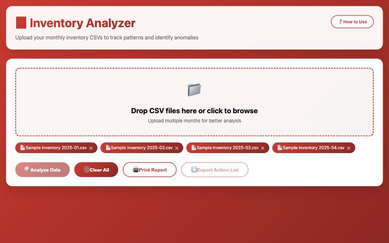
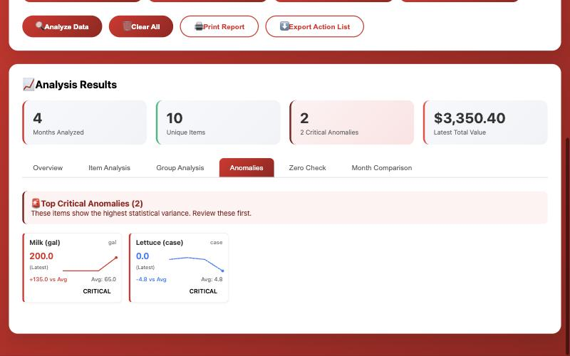

# Inventory Analyzer — Setup Guide

A second pair of eyes on your end-of-month inventory. Load this month's count next to the last few months, and it flags the items that jumped, dropped to zero or went missing, so you can recount them before the numbers are final. It's one web page. There's nothing to install and no Google setup. **Plan on about 5 minutes, on a computer.**

---

## Before you start

- [ ] **A computer with Chrome, Edge or Safari,** connected to the internet
- [ ] **Signal access,** to export your month-end inventory as a CSV
- [ ] **This month's count plus at least 2–3 earlier months.** More months make the flags more accurate.

---

## Step 1: Open the tool

Click **[Open the Inventory Analyzer](inventory-analyzer.html)**. Bookmark the page so you can come back to it.

Want a copy that lives on your computer instead? Right-click the same link, choose **Save Link As…**, and open the saved file whenever you need it.

## Step 2: Export your months from Signal

1. In **Signal**, go to **Inventory Reports** for the month you counted.
2. Choose **Export as CSV**.
3. Repeat for each earlier month you want to compare against.

**Don't open the files in Excel and save them again.** Use the raw files exactly as Signal gives them.

## Step 3: Add the files

1. Drag the CSV files onto the dashed box, or click the box and pick them.
2. **Add them oldest to newest.** The last file added is treated as the latest month. Each file shows as a red tag under the box, in order.

## Step 4: Analyze

1. Click **🔍 Analyze Data**.
2. Open the **Anomalies** tab. Critical items moved the most compared with your usual counts. Look for typos like 100 instead of 10.
3. Open the **Zero Check** tab. These items are usually stocked but are 0 or missing this month.
4. Click **⬇️ Export Action List** for a CSV checklist to take to the floor, or **🖨️ Print Report**.

The **❓ How to Use** button in the tool repeats these steps.

---

## Where your data is kept

- **Nothing is uploaded anywhere.** Your files are read inside your own browser.
- **The CSV files you add are remembered in this browser on this computer,** so they're still there next month. Click **Analyze Data** again to see results.
- Remove a month with its **✕**, or everything with **🗑️ Clear All**.
- The online link and a saved copy on your computer keep their files separately.

## How to know it worked

- **Analysis Results** shows four cards: Months Analyzed, Unique Items, Anomalies and Latest Total Value.
- Months Analyzed matches the number of files you added.
- The **Item Analysis** tab lists your items by group with average counts.

## If something goes wrong

1. **"Warning: Could not save to local storage."** The files are too big to remember. The analysis still works this time. Remove the oldest months with **✕** so the rest can be saved.
2. **Items show as "Unknown Item," or totals are $0.** The tool reads columns by name: Description or Item, Count or Qty, Cost or Price, Extension or Total, and Group or Category. Re-export the raw CSV from Signal without editing it.
3. **The months are in the wrong order.** Click **🗑️ Clear All**, then add the files one at a time, oldest first.
