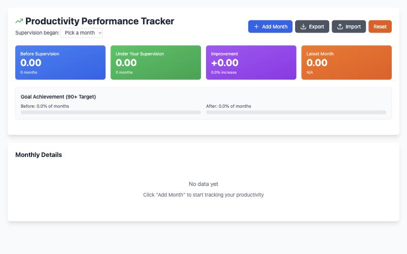
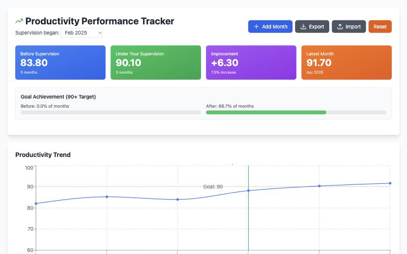

# Productivity Tracker — Setup Guide

Track your monthly productivity (sales per labor hour) on one chart, and compare the months before you took over with the months since. It's one web page. There's nothing to install and no Google setup. **Plan on about 5 minutes, plus a minute per month of history you enter.**

---

## Before you start

- [ ] **A computer with Chrome, Edge or Safari,** connected to the internet
- [ ] **For each month: productivity, total sales and total labor hours.** Enter productivity as you report it; the tool doesn't calculate it from sales and hours.
- [ ] **Optional:** the month you started supervising, to see before vs. after

---

## Step 1: Open the tool

Click **[Open the Productivity Tracker](productivity-tracker.html)**. Bookmark the page so you can come back to it.

Want a copy that lives on your computer instead? Right-click the same link, choose **Save Link As…**, and open the saved file whenever you need it. It still needs the internet to load.

## Step 2: Add your months

1. Click **+ Add Month**.
2. Type the month, e.g. `Oct 2025`. Write every month the same way.
3. Enter **Productivity**, **Total Sales** and **Total Hours**.
4. Click **Add to Database**.
5. Repeat for each month, **oldest first**. The chart and the before/after split follow the order you add them.

Already have the numbers in a spreadsheet? Save it as a CSV with the columns `Month,Productivity,Total Sales,Total Hours` and click **Import**. **Import replaces everything already in the tracker.**

## Step 3: Pick your start month

Next to **Supervision began**, choose the month you took over. Months before it count as "Before Supervision"; that month and later count as "Under Your Supervision." Skip it and every month counts as "under."

## Step 4: Back up

Click **Export** now and then to save a CSV of everything. **Import** puts it back, on this computer or another one.

---

## Where your data is kept

- **Nothing is uploaded anywhere.** Your months and your start month are saved **in this browser on this computer only.**
- A different computer, a different browser or a private window starts empty. So does clearing your browser data.
- The online link and a saved copy on your computer keep their data separately.
- **Reset** deletes every month. Export first if you might want them back.

## How to know it worked

- The four colored cards show numbers, and the **Productivity Trend** chart draws a line with a red dashed goal line at 90.
- Your months are listed under **Monthly Details**, newest at the top, with a ✓ for each month at or above 90.
- Close the tab and open it again. Your months are still there.

## If something goes wrong

1. **The page is blank.** The tracker loads its parts from the internet each time it opens. Check your connection and reload. On a work network that blocks outside sites, try another network or browser.
2. **"Before Supervision" shows 0.00.** Pick your start month next to **Supervision began**. If it's your first month, there's nothing before it to compare.
3. **The months are out of order.** They stay in the order you added them. Export, sort the rows in a spreadsheet, save as CSV, then Import it back.
