# Schedule Counter (Sheets) — Setup Guide

This gets the full Schedule Counter running for your store: staffing by the hour against your real sales, a weekly forecast that learns your sales pattern, and reminders that keep it fed. You don't need to know anything about code. **Plan on about 30 minutes, on a computer** (not a phone).

Just want to check one schedule without any setup? Use the [no-setup version](../schedule-counter/) instead.

---

## Before you start

Have these ready:

- [ ] **A Google account for your store,** not your personal one. Your sales history is saved in that account's Google Drive, and reminder emails go out from it.
- [ ] **CFA Home access to Analytics Hub** (ThoughtSpot). Step 7 sets up a weekly sales sync from there.
- [ ] **Your restaurant number,** for the ThoughtSpot store filter
- [ ] **HotSchedules access** to export your weekly schedule
- [ ] **The email address that should get alerts** if a weekly job fails

---

## Step 1: Make your own copy

1. Click this link: **[Make my copy of Schedule Counter](https://docs.google.com/spreadsheets/d/1sbW5P4zsiJadFIv7xE1eX8RiBF38gwWNp3e5_lDrNu8/copy)**. If Google asks you to sign in first, use your store account.
2. Google shows a **Copy document** screen. The yellow note says the attached script will be copied too. That's the tool itself, and it's supposed to come along.
3. Click the blue **Make a copy** button.

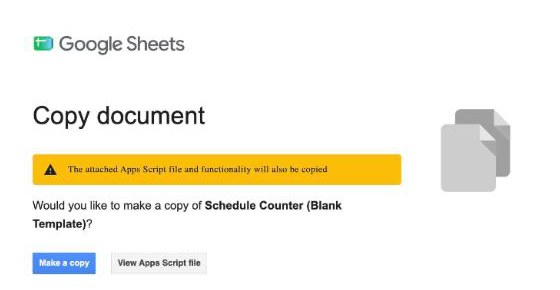

Your copy opens, named "Copy of Schedule Counter (Blank Template)". Rename it to something you'll recognize in Step 7, like "Main Street Schedule Counter". It's blank and belongs only to you.

## Step 2: Start the setup

1. Wait about 10 seconds for the sheet to finish loading.
2. In the menu bar at the top (File, Edit, View…), click **📊 Schedule Counter Setup**, then **Start Setup**.

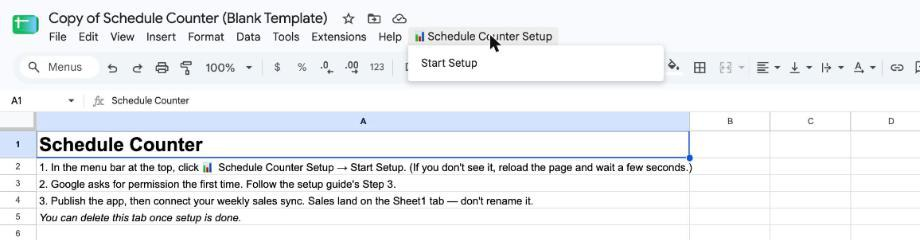

Don't see 📊 Schedule Counter Setup? Reload the page and wait a little longer. If it still isn't there after two reloads, make a new copy from the Step 1 link. Once in a while Google makes a copy without the tool attached.

## Step 3: Give the tool permission (one time only)

Google asks you to approve the tool before it can build tabs and send reminder emails. This is normal, and you only do it once. The sign-in screens open in a **new tab**.

**"Authorization required."** Click **OK**. If Google asks which account to use, pick your store account.

**"Google hasn't verified this app."** This looks alarming, but it's expected. The "app" is your own copy, so the developer named on that screen is your own account.
1. Click **Advanced** (small gray link, bottom left).
2. Click **Go to Schedule Counter (Blank Template) (unsafe)** at the bottom.

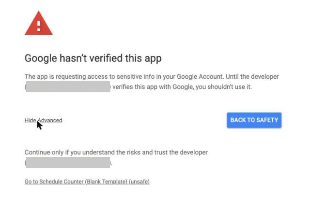

**"Sign in to Schedule Counter."** You may not see this one. If you do, check it shows your store account and click **Continue**.

**The list of permissions.** Tick **Select all** at the top, then click **Continue**. The tool can only *send* email. It can't read your inbox.

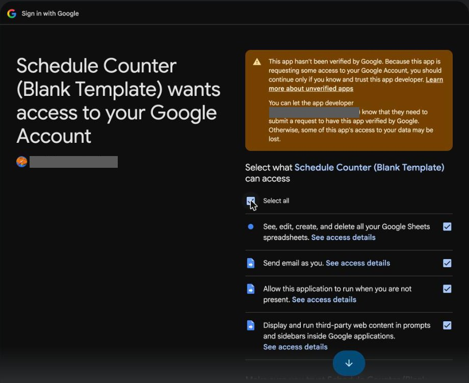

The sign-in tab closes and the setup carries on in your sheet by itself.

## Step 4: Enter the alert email

1. In the **Schedule Counter Setup** box, type the email that should hear about it if a weekly job fails or no sales data arrived.
2. Click **Save and build**. In about 20 seconds it builds every tab and turns on three weekly jobs: a Sunday night sales check, Monday morning processing, and a Thursday schedule reminder.

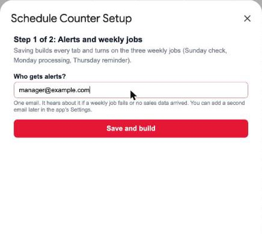

## Step 5: Publish the app

This turns your sheet into the web page your managers use.

1. In the menu bar, click **Extensions → Apps Script.** A new tab opens. Leave the code alone. If a "You're currently signed in as…" box pops up, check it's your store account and click **OK**.
2. Click the blue **Deploy** button (top right), then **New deployment**.
3. Check that it says **Web app**, that **Execute as** says **Me**, and that **Who has access** says **Anyone**. They're filled in already.
4. Click **Deploy**. If Google asks again, click **Authorize access** and approve it the same way as Step 3.

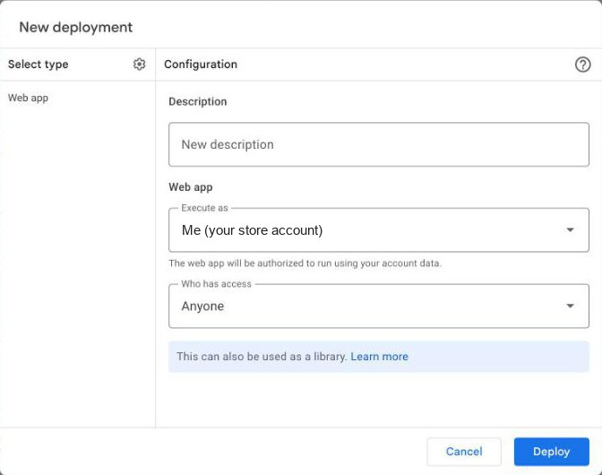

5. Copy the **Web app URL**. **That's your team's link.** Bookmark it.

Anyone with the link can open the app, so share it with your managers only.

## Step 6: Open the app and finish its setup

1. Open your team's link. The first load takes 10–20 seconds.
2. A **Schedule Counter Setup** welcome screen appears. Click **Get Started**.

   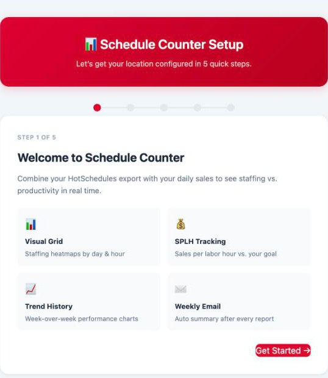

3. **Initialize Spreadsheet:** click it. Your tabs already exist, so it just checks them.
4. **Location & Notifications:** enter your store name and the email that should get the weekly labor summary. Click **Save & Continue**.

   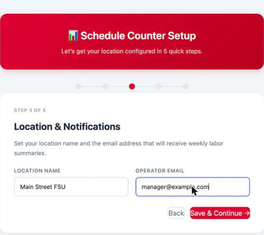

5. **Automated Triggers:** click **Install Triggers**. They're already on from Step 4, so nothing gets doubled up.
6. **Sales Curves:** click **Accept Defaults & Launch**.

## Step 7: Connect your weekly sales

This is what makes the tool run itself. Once a week, CFA Analytics drops last week's hourly sales into the **Sheet1** tab of your sheet, right before the tool's Sunday 10 PM check. You only set it up once.

**Part A: Build the search.**
In **CFA Home → Analytics Hub → Custom Reports → ThoughtSpot Search**, open **Sales Analytics** and build a search with:
- **Sales**, **Hour (24 hr)** and **Business Date**
- the time filter **this week**
- **sort by Business Date** and **sort by Hour (24 hr)**
- a store filter for **your restaurant by number**, with all sales channels

**Part B: Add the "Today date" formula.**
1. In the column panel, click **+ Add → Formula**.

   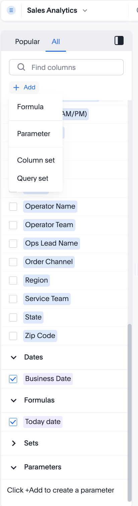

2. Name it **Today date**, type **today()**, and click **Save**. It should say "Formula is ready to save".

   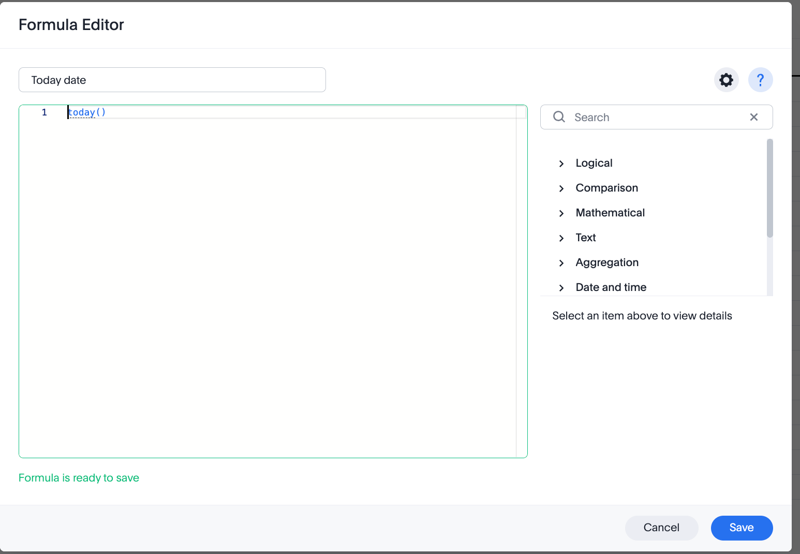

3. Tick its box, along with **Hour (24 hr)**, **Business Date** and **Sales**. Your search tokens across the top should look like this:

   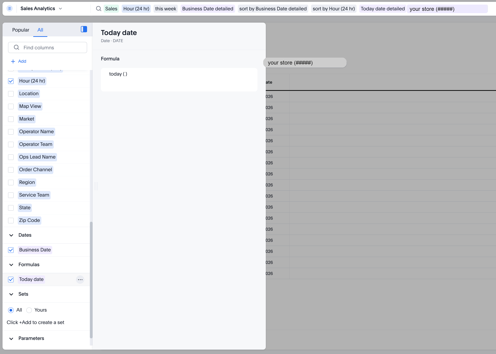

**Part C: Set up the weekly sync.**
1. Click the **…** menu → **Sync → Sync to Sheets**. Link your Google account the first time it asks, using your store account.

   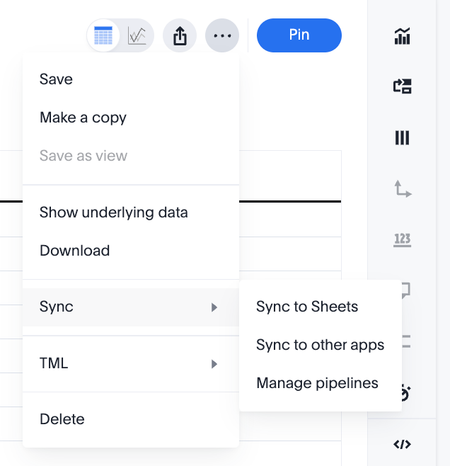

2. In the pipeline editor, set:
   - **File name:** your Schedule Counter sheet from Step 1
   - **Sheet name:** **Sheet1**
   - **Cell:** **A1**
   - **Sync schedule:** ticked, **Week**, **21:00**, your time zone, **SU** (Sunday)
3. Click **Save**.

   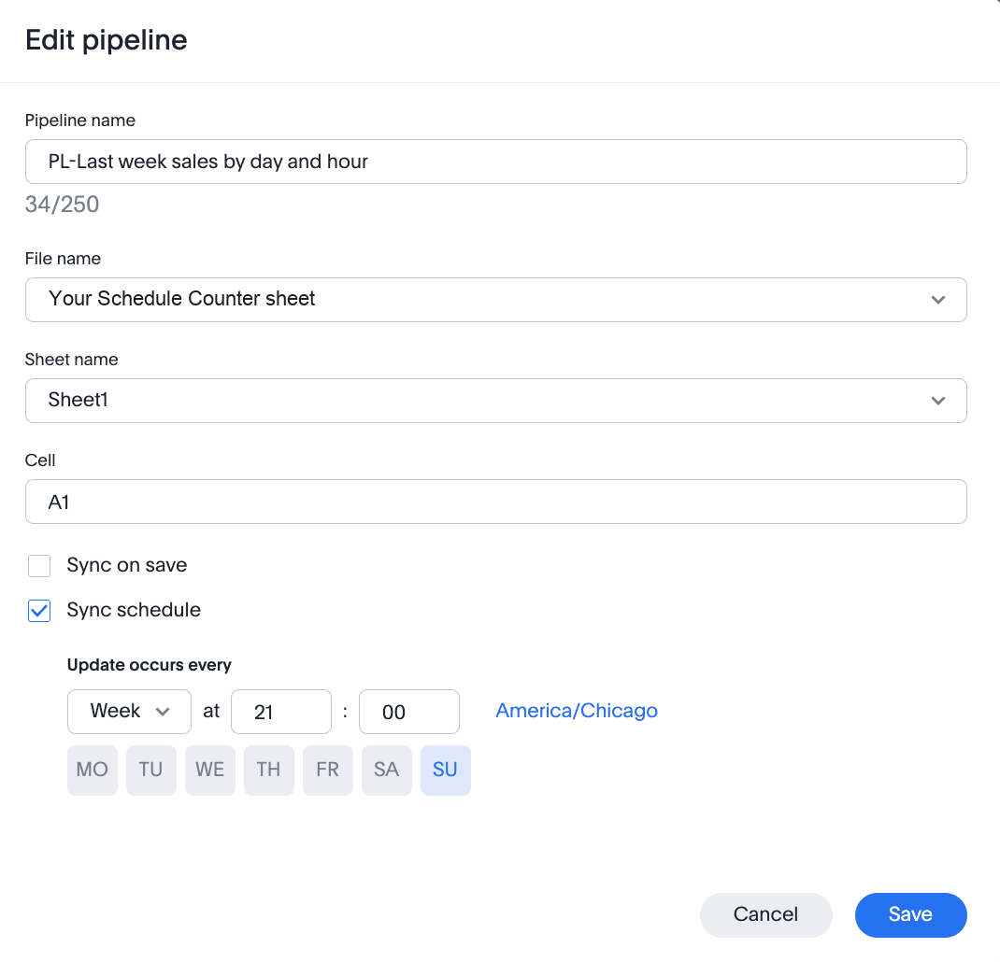

**Timing matters.** The sync has to land before the tool's Sunday 10 PM check. 9 PM Sunday gives an hour of cushion.

After the first sync, row 1 of **Sheet1** reads: **Hour (24 hr) · Business Date · Today date · Total Sales**.

## Step 8: Load your first week

Once sales are in **Sheet1** (after the first Sunday sync):

1. In the app, open **Settings** and scroll to the bottom, to **Automation**.
2. Check that all three jobs say **Active**.
3. Click **Backfill History**, then **Rebuild Curves**.

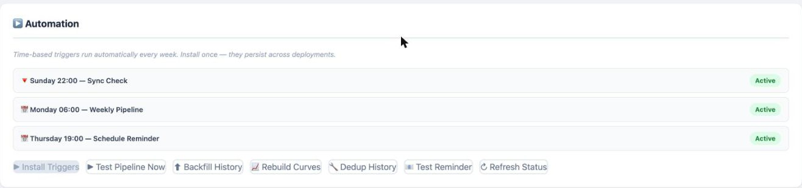

---

## How to know it worked

1. **Settings → Automation** shows three **Active** jobs.
2. After **Backfill History**, a green message says how many rows it added.
3. The **Forecast** tab shows next week's sales by day.

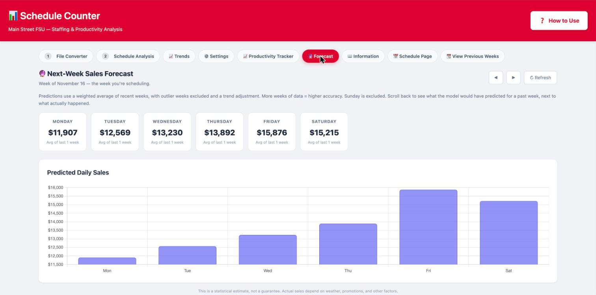

4. On the **File Converter** tab, convert your HotSchedules export, then load it on **Schedule Analysis**. You get a staffing grid by day and hour.

If all four look right, you're live. From here it runs itself: every Monday morning it files last week's sales, updates the forecast, and clears **Sheet1** for the next sync.

---

## If something goes wrong

**1. A Sunday email says the sales sync may have failed.**
- In ThoughtSpot, open **… → Sync → Manage pipelines** and check the pipeline ran.
- Check **Sheet1** has rows with last week's **Business Date**, and that row 1 has the four headers from Step 7.

**2. "Sheet1 missing required columns."**
The search in Step 7 is missing a column. The tool needs headers containing **Hour**, **Business Date** and **Total Sales**.

**3. Blank white page, or "Loading…" that never finishes.**
Wait 20 seconds and reload. If you changed anything in Apps Script, publish again with **Deploy → Manage deployments → ✏️ → Version: New version → Deploy**. The link stays the same.

**4. The forecast never updates.**
Open **Settings → Automation**. If a job isn't **Active**, click **Install Triggers**. If you skipped **Select all** in Step 3, run **📊 Schedule Counter Setup → Start Setup** again and tick **Select all** when asked.

**5. The 📊 Schedule Counter Setup menu never appears.**
Reload twice. If it's still missing, make a fresh copy from Step 1. Once in a while Google copies the sheet without the tool attached.

**Don't rename the Sheet1 tab,** and don't edit the **app_cache** tab. You can delete the **Start Here** tab once setup is done.
