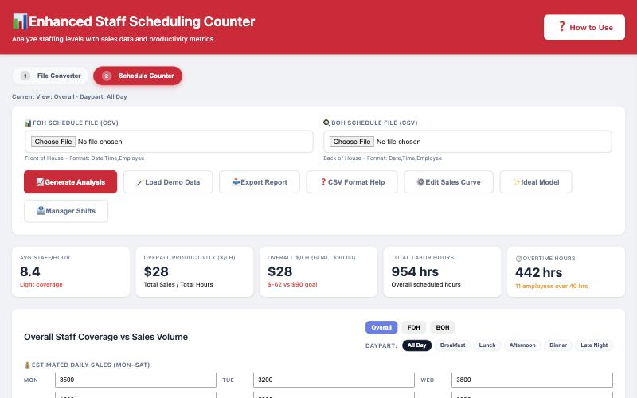
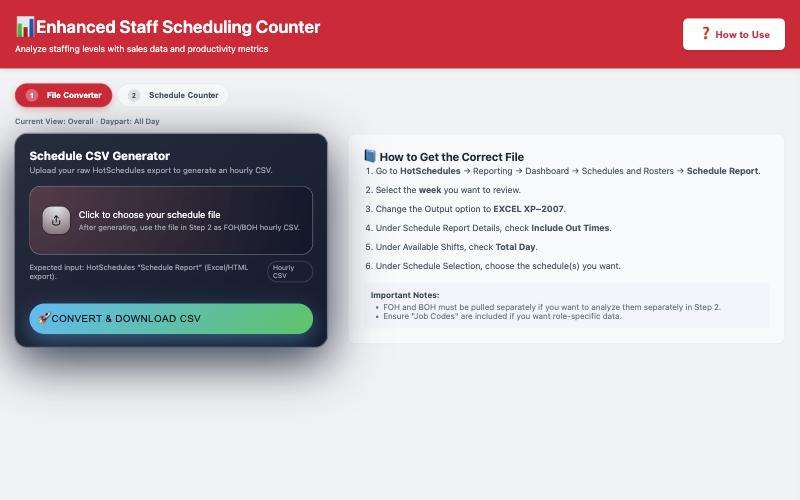
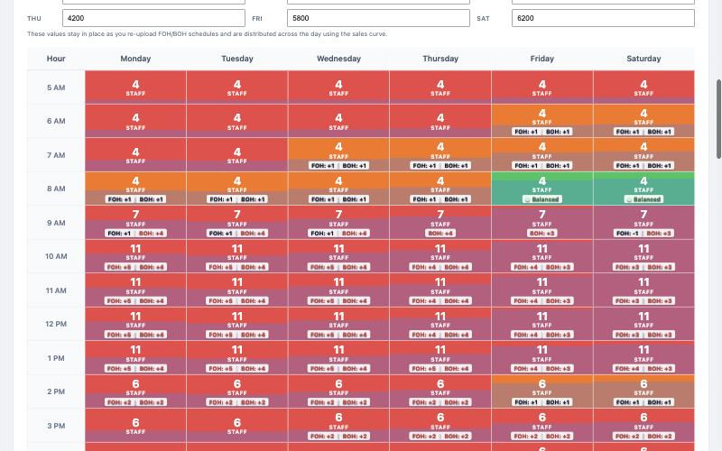

# Schedule Counter (No-Setup Version) — Setup Guide

See how many people you have scheduled each hour next to what your sales forecast says you need, then get a list of hours to cut, add or watch for burnout. It's one web page. There's nothing to install and no Google setup. **Plan on about 10 minutes the first time, on a computer** (not a phone).

---

## Before you start

- [ ] **A computer with Chrome, Edge or Safari,** connected to the internet
- [ ] **HotSchedules access,** to pull the week's Schedule Report
- [ ] **A sales estimate for each day,** Monday through Saturday
- [ ] **Your productivity goal** in sales per labor hour, e.g. $90, and your rough FOH / BOH labor split

---

## Step 1: Open the tool

Click **[Open the Schedule Counter](schedule-counter.html)**. Bookmark the page so you can come back to it.

Want a copy that lives on your computer instead? Right-click the same link, choose **Save Link As…**, and open the saved file whenever you need it. It still needs the internet to draw its charts.

## Step 2: Try it with demo data (optional)

1. Click the **2 Schedule Counter** tab.
2. Click **🪄 Load Demo Data**, then **OK**.

The grid, charts and action list fill in with made-up staff and sales, so you can see what you're working toward. Loading your own files replaces the demo.

## Step 3: Pull your schedule from HotSchedules

1. In HotSchedules go to **Reporting → Dashboard → Schedules and Rosters → Schedule Report**.
2. Pick the **week** you want to review.
3. Set Output to **EXCEL XP–2007**.
4. Under Schedule Report Details, tick **Include Out Times**.
5. Under Available Shifts, tick **Total Day**.
6. Under Schedule Selection, choose the schedule you want. **Run FOH and BOH as two separate reports** if you want to see them separately.

The same steps are on the tool's **1 File Converter** tab.

## Step 4: Convert the file

1. On the **1 File Converter** tab, click **Click to choose your schedule file** and pick the report you just downloaded.
2. Click **🚀 Convert & Download CSV**. A file named like `schedule hours for 11-10-11-16.csv` lands in your Downloads folder.
3. Do it again for your second report (FOH and BOH each get their own CSV).

## Step 5: Load the converted files

1. Click the **2 Schedule Counter** tab.
2. Put the FOH CSV in **FOH Schedule File** and the BOH CSV in **BOH Schedule File**. You can also drag a file onto either box.
3. Type your sales estimate for each day in **Estimated Daily Sales (Mon–Sat)**.

## Step 6: Set your goals (first time only)

1. Click **⚙️ Edit Sales Curve**.
2. Set your **Productivity Goals** (Overall, FOH, BOH) and your **Labor Mix** percentages.
3. Check the **Percent of Daily Sales by Hour** column. It's how each day's sales are spread across the hours. Adjust it to match your store.
4. Click **Close**. The tool remembers these settings next time.

## Step 7: Run it

Click **📈 Generate Analysis**. Use the **Overall / FOH / BOH** and **Daypart** buttons to change what you're looking at. Click any hour to see who's on.

---

## Where your data is kept

- **Nothing is uploaded anywhere.** Your files are read inside your own browser.
- **Remembered on this computer, in this browser:** your sales curve, goals, labor mix, daily sales estimates and any manager names you type in.
- **Not remembered:** the schedule files and employee names. Load the CSVs again each time you open the page.
- The online link and a saved copy on your computer keep their settings separately.

## How to know it worked

- The five cards at the top show numbers: Avg Staff/Hour, Productivity, $/LH vs goal, Total Labor Hours and Overtime.
- The grid is colored by hour. Green is on target; red and orange are off.
- **💡 Optimization Insights** lists hours to cut, add or watch for burnout.

## If something goes wrong

1. **"This looks like a raw HotSchedules export!"** You put the HotSchedules report straight into Step 5. Convert it on the **1 File Converter** tab first (Step 4), then load the CSV it downloads.
2. **The $/LH card says N/A or "Enter daily sales estimates."** Type a sales number for each day you're open, Monday to Saturday.
3. **The converter says no schedule data was found, or shifts land on the wrong days.** Re-run the HotSchedules report with Output set to **EXCEL XP–2007** and both **Include Out Times** and **Total Day** ticked, then convert again. Open the CSV and check a few shifts against HotSchedules before you trust the numbers.
