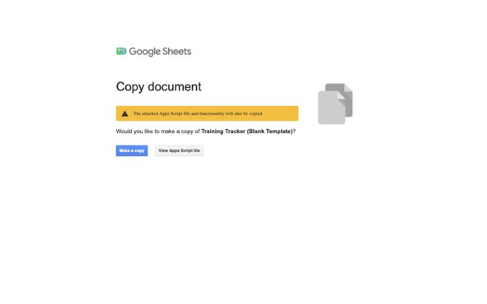
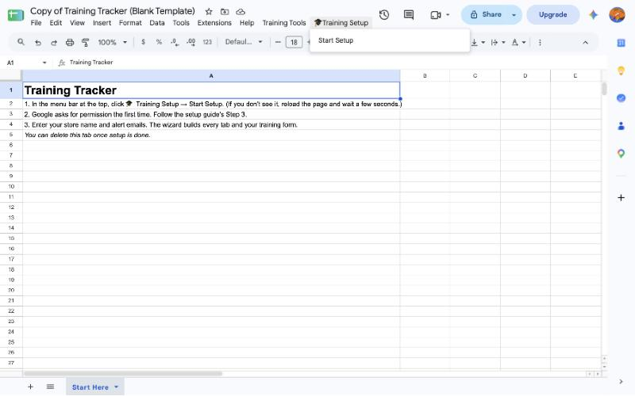
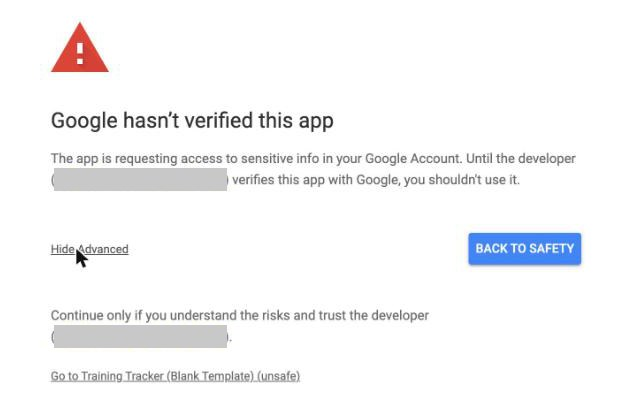
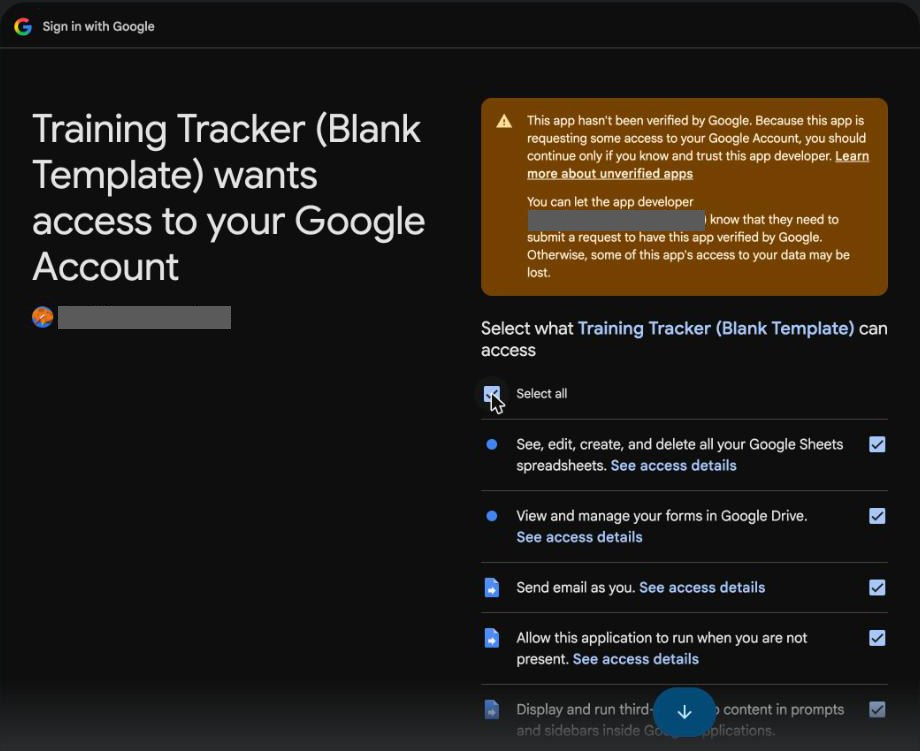
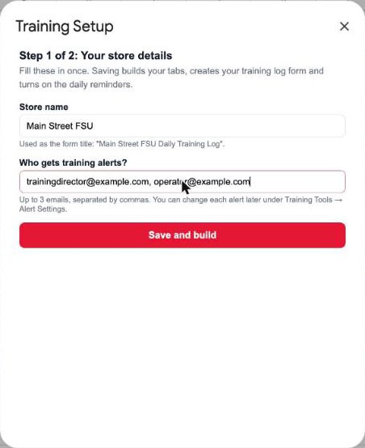
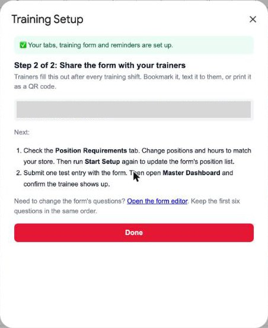
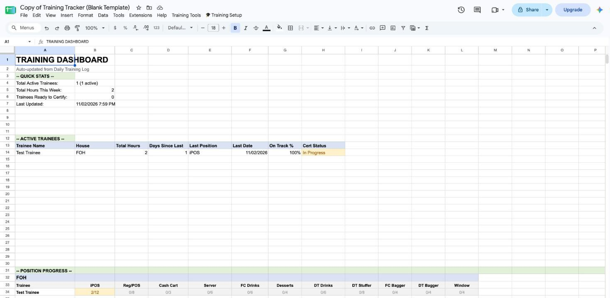

# Training Tracker — Setup Guide

This gets your store's training tracker running from scratch. You don't need to know anything about code, and you'll never have to open or paste any. **Plan on about 15 minutes, on a computer** (not a phone).

---

## Before you start

Have these ready. The setup asks for each one once:

- [ ] **A Google account for your store,** not your personal one. The training form and alert emails belong to whichever account makes the copy, so use the one your team shares.
- [ ] **Your store name** as your team knows it, e.g. "Main Street FSU"
- [ ] **Up to 3 email addresses** that should get training alerts (usually your Training Director and Operator)
- [ ] **Your training positions and hours** (optional). The tracker starts with a typical FOH/BOH list you can edit in Step 6.

---

## Step 1: Make your own copy

1. Click this link: **[Make my copy of the Training Tracker](https://docs.google.com/spreadsheets/d/1q9oulbaz5wc4amtu6WDWCXAVCZ36eAXpbnU9FgGFDD4/copy)**. If Google asks you to sign in first, use your store account.
2. Google shows a **Copy document** screen. The yellow note says the attached script will be copied too. That's the tool itself, and it's supposed to come along.
3. Click the blue **Make a copy** button.

Your copy opens, named "Copy of Training Tracker (Blank Template)". You can rename it any time by clicking the name. It's blank and belongs only to you. Nobody else can see what you put in it.

## Step 2: Start the setup

1. Wait about 10 seconds for the sheet to finish loading.
2. In the menu bar at the top (File, Edit, View…), click **🎓 Training Setup**, then **Start Setup**.

Don't see 🎓 Training Setup? Reload the page and wait a little longer. It's always the last item in the menu bar.

## Step 3: Give the tool permission (one time only)

Google asks you to approve the tool before it can build your form and send alert emails. You'll see **four screens** in a row. This is normal, and you only do it once. The sign-in screens open in a **new tab**.

**Screen 1: "Authorization required."** Click **OK**. If Google asks which account to use, pick your store account.

**Screen 2: "Google hasn't verified this app."** This looks alarming, but it's expected. The "app" is your own copy, so the developer named on that screen is your own account. Google shows this for any spreadsheet tool that isn't sold in its store.
1. Click **Advanced** (small gray link, bottom left).
2. Click **Go to Training Tracker (Blank Template) (unsafe)** at the bottom.

**Screen 3: "Sign in to Training Tracker."** Check it shows your store account, then click **Continue**.

**Screen 4: the list of permissions.** Tick **Select all** at the top, then click **Continue**.

The sign-in tab closes and the setup carries on in your sheet by itself. If nothing happens after about 30 seconds, click **🎓 Training Setup → Start Setup** again.

## Step 4: Answer the setup questions

The sheet builds its tabs first (about 20 seconds). Then a **Training Setup** box opens:

1. **Store name.** It goes in your form's title, e.g. "Main Street FSU Daily Training Log".
2. **Who gets training alerts?** Up to 3 emails, separated by commas.
3. Click **Save and build**. This takes about 30 seconds. It creates your training form, links it to the sheet, and turns on the daily reminders.

If something's missing, a red message at the top of the box tells you what to fill in.

## Step 5: Share the form with your trainers

When setup finishes, the box shows your **training form link**. Trainers fill it out after every training shift: date, trainee name, position, hours, on track or not, and notes.

- Bookmark the link on the trainer tablet, or text it to your trainers.
- To print a QR code: open the link, click the three dots (⋮) in the browser, then **Share → Create QR code**.

You can always find the form again: in the sheet, click **Tools → Manage form → Go to live form**.

## Step 6: Match the positions to your store

1. Open the **Position Requirements** tab.
2. Edit the list to match how your store trains. Each row is one position: **House** (FOH or BOH), **Position Name**, and the **Minimum / Maximum / Target Hours** a trainee should spend there.
3. When you're done, click **🎓 Training Setup → Start Setup** again and click **Save and build**. This updates the position list on your form. Your answers are already filled in.

## Step 7 (optional): The extras

Everything else lives in the **Training Tools** menu:
- **Alert Settings:** turn each alert on or off, or send different alerts to different people.
- **Generate Training Timeline:** a day-by-day plan for one new hire from their start date.
- **Review Duplicate Names:** merge "Tim" and "Timothy" into one trainee.
- **Manually Certify Trainee:** moves someone who's done training to the Certification Log.

---

## How to know it worked

1. Open your form link and submit one test entry: trainee **Test Trainee**, any position, **2** hours.
2. Back in the sheet, the **Daily Training Log** tab has a new row for Test Trainee within a few seconds.
3. The **Master Dashboard** tab lists Test Trainee under **Active Trainees**.

If all three look right, you're done. To clear the test, delete Test Trainee's row on the **Daily Training Log** tab and on the **Form Responses 1** tab, then click **Training Tools → Refresh Dashboard**.

---

## If something goes wrong

**1. Form entries don't show up on the Daily Training Log.**
- Click **Training Tools → Sync Form Data.** This copies any missing form entries over.
- Then click **🎓 Training Setup → Start Setup → Save and build** once. It puts back anything that's missing, like the link between the form and the sheet, and never erases data.

**2. No alert emails arrive.**
- Open **Training Tools → Alert Settings** and check the alert is on and the email is right.
- Check the spam folder of the person who should get it.
- If you skipped **Select all** in Step 3, Google never gave the tool permission to send email. Click **Extensions → Apps Script**. Pick **dailyReminderCheck** in the dropdown next to **▶ Run**, then click **▶ Run**, tick **Select all**, and click **Continue**.

**3. A position is missing from the form's dropdown.**
Add it on the **Position Requirements** tab, then run **🎓 Training Setup → Start Setup → Save and build** again.

**4. The same person shows up twice on the dashboard.**
Someone typed the name differently. Click **Training Tools → Review Duplicate Names** and merge them.

**5. The 🎓 Training Setup or Training Tools menu is missing.**
Reload the sheet and wait about 10 seconds. Re-running **Start Setup** is always safe. It shows what you entered before and never erases data.
